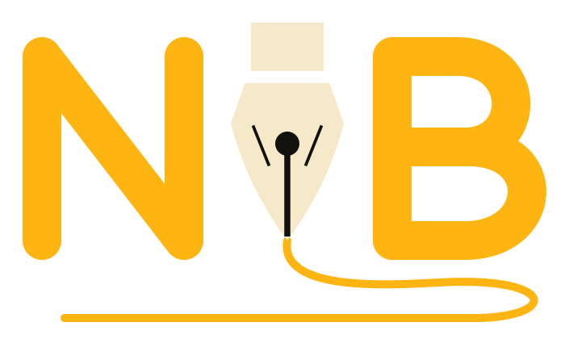

<p align="center">
  
</p>

<h1 align="center">NibMotion</h1>
<p align="center"><strong>Motion that follows your UI.</strong></p>

<p align="center">
  A physics-driven motion framework for Flutter. Build with declarative targets,
  interruptible springs, gestures, layout transitions, and GPU effects.
</p>

<p align="center">
  <a href="https://pub.dev/packages/nib_motion"></a>
  <a href="https://github.com/oraclevs/nib_motion/actions/workflows/ci.yml"></a>
  <a href="https://github.com/oraclevs/nib_motion/blob/main/LICENSE"></a>
</p>

<p align="center">
  <a href="https://www.nibmotion.xyz/docs/motion/introduction">Read the guides</a> ·
  <a href="https://www.nibmotion.xyz/playground/spring-retarget">Try a spring</a> ·
  <a href="https://www.nibmotion.xyz/examples">Explore demos</a> ·
  <a href="https://github.com/oraclevs/nib_motion/blob/main/doc/migration.md">Migration</a> ·
  <a href="https://pub.dev/packages/nib_motion">pub.dev</a>
</p>

Describe the state your interface should reach. When that state changes again,
NibMotion can retarget a spring from its current position and velocity.
Gestures, reactive values, layout, and exit animations share the same motion primitives.

## Interactive Motion Gallery

Explore spring retargeting, drag and inertia, layout transitions, and presence
in a running Flutter app. All 29 examples remain available in the gallery.

<p align="center">
  <a href="https://github.com/oraclevs/nib_motion/blob/feat/interactive-showcase-0.3.6/assets/showcase/nibmotion-showcase.mp4"></a>
</p>

[Watch the full gallery recording](https://github.com/oraclevs/nib_motion/blob/feat/interactive-showcase-0.3.6/assets/showcase/nibmotion-showcase.mp4) · [Run the interactive examples](example/README.md)

## Water Surface in Action

Lagoon is a two-screen Flutter app using NibMotion's **water API**.
Taps and a swipe disturb the surface, followed by a transition to an underwater
pearl hunt. Recorded in portrait on Linux with Impeller; NibMotion reported its
refractive `layerSampler` path. Water rendering varies by platform and renderer.

<p align="center">
  <a href="https://github.com/oraclevs/nib_motion/blob/feat/interactive-showcase-0.3.6/assets/showcase/nibmotion-water.mp4"></a>
</p>

[Watch the full water recording](https://github.com/oraclevs/nib_motion/blob/feat/interactive-showcase-0.3.6/assets/showcase/nibmotion-water.mp4) · [Review both recordings locally](assets/showcase/index.html) · [Capture details](doc/maintainers/water-showcase.md)

These recordings are candidates for owner review. Version 0.3.6 has not been
published; media URLs point to this showcase branch until integration is approved.

## Start with a destination

A card can enter, respond to a press, move when its layout changes, and animate
out when removed. Keeping those transitions in widget state makes them easier to
follow than coordinating a separate controller for each interaction.
`NibMotion` takes the starting values, target values, and transition together.
Use an optional controller when you need imperative control.

Requires **Flutter 3.29.0 or newer**. The package declares Dart `>=3.0.0 <4.0.0`;
Flutter 3.29 ships Dart 3.7. The only runtime dependency is the Flutter SDK.

```bash
flutter pub add nib_motion
```

Paste this complete entrance example into `lib/main.dart`, then run `flutter run`:

```dart
import 'package:flutter/material.dart';
import 'package:nib_motion/nib_motion.dart';

void main() => runApp(
      MaterialApp(
        home: Scaffold(
          body: Center(
            child: NibMotion(
              initial: const NibAnim(opacity: 0, y: 24),
              animate: const NibAnim(opacity: 1, y: 0),
              transition: NibTransition.springSnappy,
              child: const Text('Hello, NibMotion'),
            ),
          ),
        ),
      ),
    );
```

## Change your mind mid-animation

Tap the button again before the spring settles. Changing `animate` retargets the
existing motion; you don't need to stop a controller or calculate a new starting value.
This is also a complete `lib/main.dart`:

```dart
import 'package:flutter/material.dart';
import 'package:nib_motion/nib_motion.dart';

void main() => runApp(const MaterialApp(home: SpringDemo()));

class SpringDemo extends StatefulWidget {
  const SpringDemo({super.key});

  @override
  State<SpringDemo> createState() => _SpringDemoState();
}

class _SpringDemoState extends State<SpringDemo> {
  bool selected = false;

  @override
  Widget build(BuildContext context) {
    return Scaffold(
      appBar: AppBar(title: const Text('Tap again while it moves')),
      body: Center(
        child: NibMotion(
          animate: NibAnim(
            y: selected ? -40 : 0,
            scale: selected ? 1.15 : 1,
            rotate: selected ? -0.08 : 0,
          ),
          transition: NibTransition.springWobbly,
          child: FilledButton(
            onPressed: () => setState(() => selected = !selected),
            child: Text(selected ? 'Tap to reset' : 'Tap to lift'),
          ),
        ),
      ),
    );
  }
}
```

Both examples have [runnable sources](https://github.com/oraclevs/nib_motion/tree/main/example/lib/readme)
and [widget tests](https://github.com/oraclevs/nib_motion/blob/main/example/test/readme_test.dart).
See [interruption and velocity handoff](https://github.com/oraclevs/nib_motion/blob/main/doc/interruption.md)
for the driver contract, including immediate updates and cancellation.

## One motion system, across your interface

### Declarative motion

Use `initial` and `animate` targets, named variants, keyframes, and per-transition
springs or easing. Variants propagate state and stagger timing to descendants.
[Fundamentals](https://github.com/oraclevs/nib_motion/blob/main/doc/animate.mdx) ·
[Variants](https://github.com/oraclevs/nib_motion/blob/main/doc/variants.mdx) ·
[Transitions](https://github.com/oraclevs/nib_motion/blob/main/doc/transitions.mdx)

### Physics and interaction

Give a drag bounds, elastic resistance, inertia, or snap points. Press, hover,
focus, and drag states can animate the same widget. Tune springs by mass,
stiffness, and damping, or duration and bounce; use a custom Flutter `Simulation`
when your interaction needs a different model.
[Gestures](https://github.com/oraclevs/nib_motion/blob/main/doc/gestures.mdx) ·
[Drag and snap](https://github.com/oraclevs/nib_motion/blob/main/doc/drag.mdx) ·
[Physics](https://github.com/oraclevs/nib_motion/blob/main/doc/physics.md)

### Layout and presence

Animate position and size changes with FLIP, connect matching `layoutId`s inside
a scope, or reorder keyed content with `NibReorderable`. `NibPresence` keeps
removed children mounted until their exit animation finishes.
[Layout and shared transitions](https://github.com/oraclevs/nib_motion/blob/main/doc/layout.md) ·
[Presence](https://github.com/oraclevs/nib_motion/blob/main/doc/presence.mdx) ·
[Routes and dialogs](https://github.com/oraclevs/nib_motion/blob/main/doc/routes.md)

### Scroll and orchestration

Map scroll offsets to opacity or transforms through `MotionValue`s. Trigger
entrances in the viewport, track page and sliver progress, or coordinate multiple
controllers with a timeline and a scrubber.
[Motion values](https://github.com/oraclevs/nib_motion/blob/main/doc/motion-values.md) ·
[Viewport and scroll](https://github.com/oraclevs/nib_motion/blob/main/doc/viewport-and-scroll.mdx) ·
[Timelines](https://github.com/oraclevs/nib_motion/blob/main/doc/timeline.md)

### Expressive visuals

Animate text by character, word, or line; draw paths; add shimmer, dissolve, and
glass; build animated navigation. Custom fragment shaders can read motion-value
uniforms. Water rendering is available as a bounded visual effect in the stable API.
[Text](https://github.com/oraclevs/nib_motion/blob/main/doc/text.mdx) ·
[Paths](https://github.com/oraclevs/nib_motion/blob/main/doc/path.mdx) ·
[Shaders and glass](https://github.com/oraclevs/nib_motion/blob/main/doc/shaders.mdx) ·
[Navigation](https://github.com/oraclevs/nib_motion/blob/main/doc/navigation.mdx)

### Engineering and control

`MotionValue` carries a value and velocity. The core `NibMotion` render object
reads these values during paint, so continuous property animation doesn't rebuild
its child on every frame. Content changes and builder-based APIs can still rebuild.
Inspect live values, tune a spring, replay an entrance after hot reload, or take
imperative control with `NibMotionController`.
[Architecture](https://github.com/oraclevs/nib_motion/blob/main/doc/architecture.md) ·
[Debugging tools](https://github.com/oraclevs/nib_motion/blob/main/doc/debug-tools.md) ·
[Controller](https://github.com/oraclevs/nib_motion/blob/main/doc/motion-controller.mdx)

The repository includes unit and widget tests, numeric trajectory regressions,
and [reproducible benchmarks](https://github.com/oraclevs/nib_motion/tree/main/benchmark).
The [performance notes](https://github.com/oraclevs/nib_motion/blob/main/doc/performance.md)
record the workload, hardware, and measurement limits. They do not establish
frame-rate guarantees or superiority over another animation package.

## Explore real interfaces

The [example gallery](example/README.md) has 29 pages, including every original
demo, Daily Focus, both quick starts, and the new feature examples. Search or
filter by capability, share a demo's hash route, and export review notes.
From this branch's repository checkout:

```bash
cd example
flutter pub get
flutter run -d web-server --web-hostname 127.0.0.1 --web-port 8080 -t lib/demos.dart
```

Open `http://127.0.0.1:8080`. The web scaffold is committed; see the
[example instructions](example/README.md) for other platforms or package downloads.
The two quick starts also run with `-t lib/readme/entrance.dart` or
`-t lib/readme/retarget.dart`.

Daily Focus remains in the gallery and can also run from its
[source](https://github.com/oraclevs/nib_motion/blob/main/example/lib/main.dart)
with `flutter run -d chrome -t lib/main.dart` from `example/`.
Use the gallery primitives for interactive cards, navigation,
reorderable lists, overlays, scroll-driven dashboards, and onboarding transitions.
The [website demos](https://www.nibmotion.xyz/examples) offer another way to explore.

## Accessibility and compatibility

`NibMotionConfig` resolves reduced motion from an override or
`MediaQuery.disableAnimations`. The built-in animated widgets apply that policy;
custom drivers and raw simulations need your own policy handling.
[Accessibility guide](https://github.com/oraclevs/nib_motion/blob/main/doc/accessibility.md).

- Shader behavior depends on the renderer. Glass uses a blur fallback where
  refraction is unavailable; other effects have their own fallbacks. Test the
  renderer you ship.
- Layout and gesture coordinates use local logical pixels. Perspective,
  near-singular transforms, rotated reorder, and pop exits that must preserve
  ancestor clips across coordinate spaces are outside the verified layout contract.
- Water samples a designated Flutter subtree. Platform views and
  pixels outside that subtree are unsupported. It preserves original hit-test
  geometry; browser parity and sustained device performance remain unverified.

Read [compatibility and known limits](https://github.com/oraclevs/nib_motion/blob/main/doc/compatibility.md)
before choosing a rendering-heavy or complex layout effect.

## Find your next guide

The [documentation index](https://github.com/oraclevs/nib_motion/blob/main/doc/README.md)
connects the guides, API reference, examples, migration notes, and troubleshooting.
Start with [motion fundamentals](https://github.com/oraclevs/nib_motion/blob/main/doc/animate.mdx),
or read [migration guidance](https://github.com/oraclevs/nib_motion/blob/main/doc/migration.md)
if you already use Flutter controllers or another animation package.

## Build with us

Try an example, report a reproducible bug, or propose an improvement.
Documentation fixes and small regression tests are welcome contributions.
[Contributing](https://github.com/oraclevs/nib_motion/blob/main/CONTRIBUTING.md)
explains setup, checks, and public API expectations.

[Issues](https://github.com/oraclevs/nib_motion/issues) ·
[Support](https://github.com/oraclevs/nib_motion/blob/main/SUPPORT.md) ·
[Code of conduct](https://github.com/oraclevs/nib_motion/blob/main/CODE_OF_CONDUCT.md) ·
[Security](https://github.com/oraclevs/nib_motion/blob/main/SECURITY.md) ·
[Changelog](https://github.com/oraclevs/nib_motion/blob/main/CHANGELOG.md) ·
[MIT license](https://github.com/oraclevs/nib_motion/blob/main/LICENSE)
